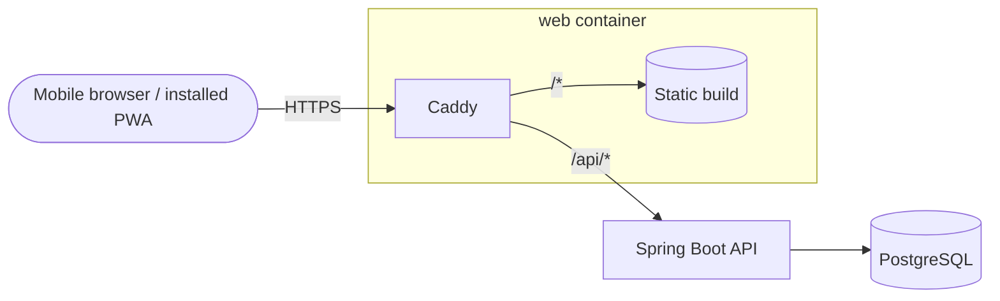

# Golify · Web app


Mobile-first web app for **football prediction games between friends**: predict the score of every LaLiga match,
create a private group, invite your friends with a link and follow the standings round by round.
It is an installable PWA built on top of the [Football Predictions API](https://github.com/raulced7/football-predictions).

**Live:** https://golifyapp.com/

<p align="center">
  
  
  
</p>

## Features

- **My round:** predict every match until kick-off, with live status, results and points per match
- **Friend groups:** create a group, share the invite code or link, join from a deep link (`/unirse/:code`)
- **Standings:** season and per-round standings with a podium and ties
- **Group predictions:** see everyone's predictions once a match has started; before that, only how many have predicted
- **Installable PWA:** home screen icon, fast start-up, update prompt for new versions and an install guide for Android and iPhone
- **Real crests** for every team, with a fallback to the team's abbreviation

## Tech stack

React 19 · TypeScript · Vite · Tailwind CSS 4 · TanStack Query · React Router · React Hook Form + Zod ·
openapi-fetch + openapi-typescript · vite-plugin-pwa (Workbox) · oxlint · Prettier · Caddy · Docker · GitHub Actions

## Highlights

- **Types generated from the API's OpenAPI spec**, so a backend change that breaks the contract fails the build
- **A mapping layer** turns API responses into strict front-end models (`features/*/model.ts`), so components never deal with optional fields
- **Server state with TanStack Query:** caching, invalidation after mutations and polling only while a match is live
- **Organized by feature** (`auth`, `rounds`, `groups`, `pwa`…), the same way as the backend
- **Route-level code splitting:** each page is downloaded the first time it is visited
- **State in the URL** (`?jornada=12`, `?vista=jornada`), so the back button and shared links work as expected
- **Accessibility:** native `<dialog>` and `<select>`, tabs and progress bars with ARIA roles, labelled controls
- **Caching strategy:** hashed assets are cached forever, the app shell is precached by the service worker, and API calls always go to the network

## Architecture



In production, Caddy serves the static build and proxies `/api` to the backend over a private network, so the front
and the API share the same origin and no CORS configuration is needed. Deployed on Railway.

## Getting started

**Prerequisites:** Node.js 24 and the [backend](https://github.com/raulced7/football-predictions) running on `localhost:8080`.

```bash
git clone https://github.com/raulced7/football-predictions-front.git
cd football-predictions-front
npm install
npm run dev
```

The Vite dev server proxies `/api` to `http://localhost:8080`.

| Script                 | What it does                                              |
| ---------------------- | --------------------------------------------------------- |
| `npm run dev`          | Development server                                        |
| `npm run build`        | Type check and production build                           |
| `npm run preview`      | Serve the production build (service worker included)      |
| `npm run lint`         | oxlint                                                    |
| `npm run format`       | Prettier                                                  |
| `npm run generate:api` | Regenerate `src/api/schema.d.ts` from the running backend |

## Author

**Raúl Cedeño Rojo** — Backend Developer (Java · Spring Boot) · [LinkedIn](https://www.linkedin.com/in/raulcedroj/)

Football data provided by [football-data.org](https://www.football-data.org).
